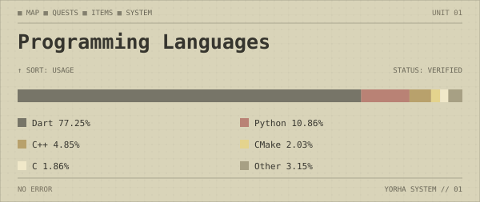
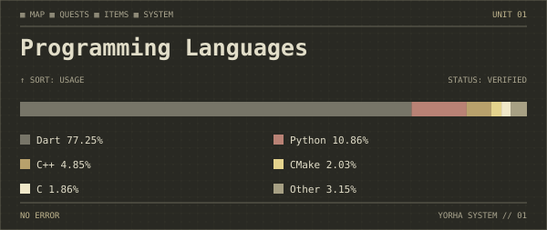

# YoRHa Card Generator

<p align=center>
    
</p>

Generates cards based on the YoRHa systems HUD
from Nier:Automata.

Zero external dependencies - generate SVGs using Python's standard library.

## Cards

For now only `Most Used Languages` is supported in dark and light theme versions.

<table>
  <tr>
    <td>
      
      <p align="center">Light theme</p>
    </td>
    <td>
      
      <p align="center">Dark theme</p>
    </td>
  </tr>
</table>

## How to use

<p align="center">
    
</p>

For now it is used by creating a GitHub Actions workflow:

``` yaml
name: Update Card Assets

on:
  schedule:
    # Schedule an card update in a six hour range
    - cron: "0 */6 * * *" 
  
  workflow_dispatch:

jobs:
  update:
    runs-on: ubuntu-latest

    # Give write permission
    permissions:
      contents: write

    steps:
      - name: Checkout profile
        uses: actions/checkout@v4
        with:
          path: profile

      - name: Checkout card generator
        uses: actions/checkout@v4
        with:
          repository: yorha-dev/yorha_card_generator
          path: generator
          ref: main

      - name: Setup Python
        uses: actions/setup-python@v5
        with:
          python-version: '3.14'

      - name: Generate SVG
        working-directory: generator
        # Use env variables [OPTIONAL]
        env:
            GITHUB_TOKEN: ${{secrets.GITHUB_TOKEN}}
        # Use --username and put your user name
        run: |
          python generator.py --username [YOUR_USER_NAME]

      - name: Update profile card
        run: |
          cp generator/output/*.svg profile/assets

      - name: Commit changes
        working-directory: profile
        run: |
          git config user.name "github-actions[bot]"
          git config user.email "41898282+github-actions[bot]@users.noreply.github.com"

          git add assets/*

          if ! git diff --cached --quiet; then
            git commit -m "chore: update cards"
            git push
          fi

```

Add cards to your profile `README.md`:

```html
<picture>
    <source media="(prefers-color-scheme: dark)"
        srcset="assets/languages-dark.svg"/>
    <source media="(prefers-color-scheme: light)"
        srcset="assets/languages-light.svg"/>
    
</picture>
```

**Glory to Mankind**
